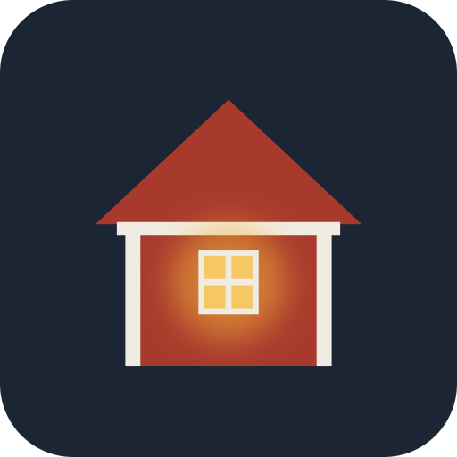
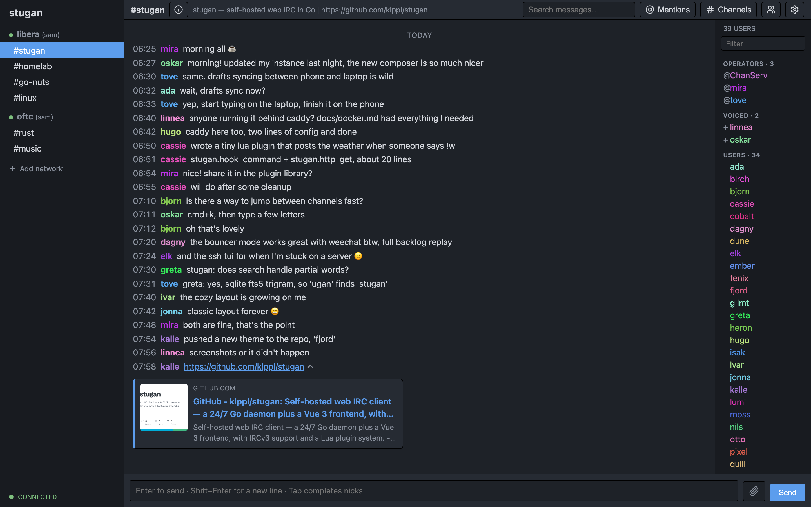
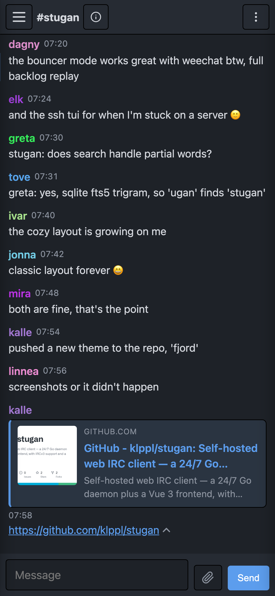
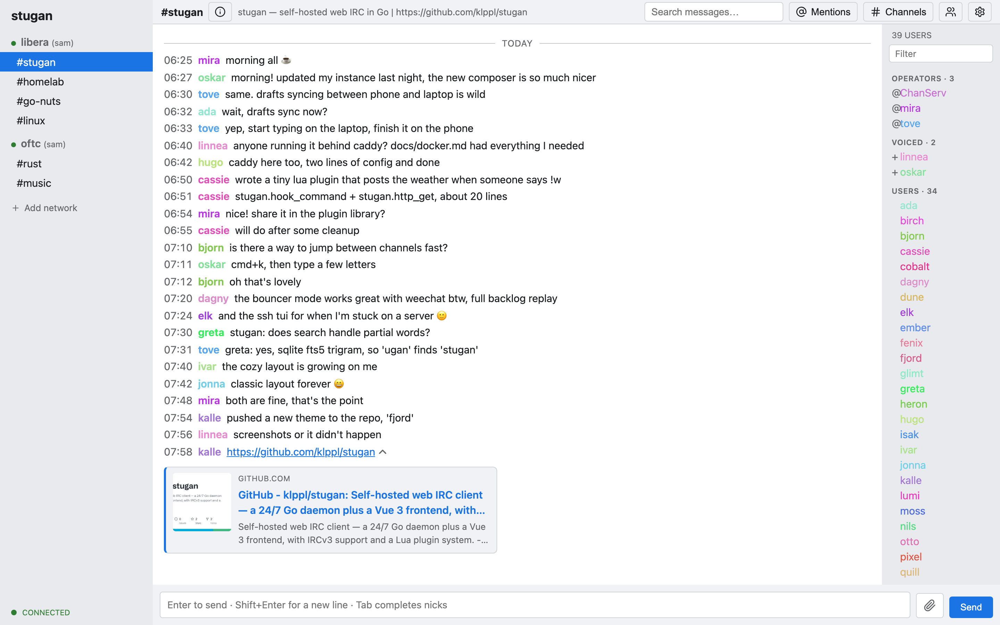
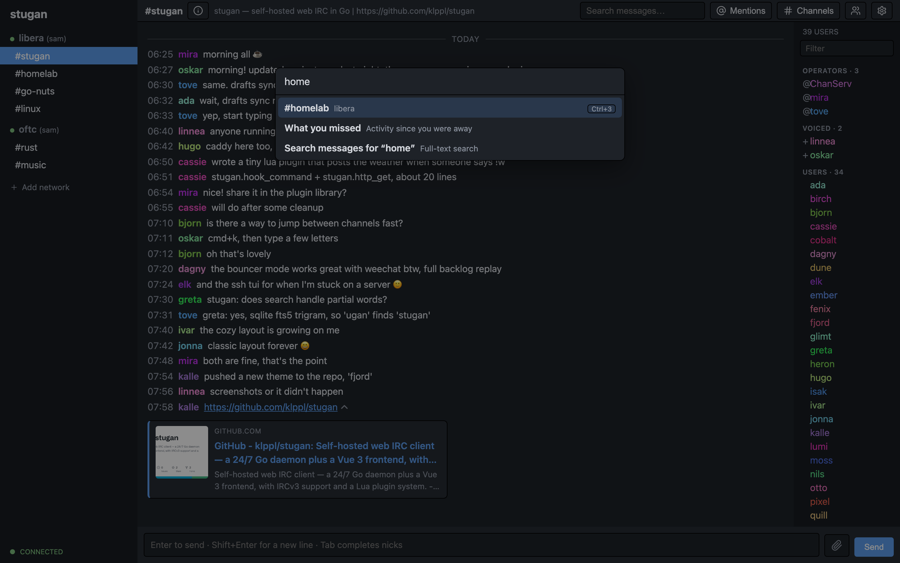
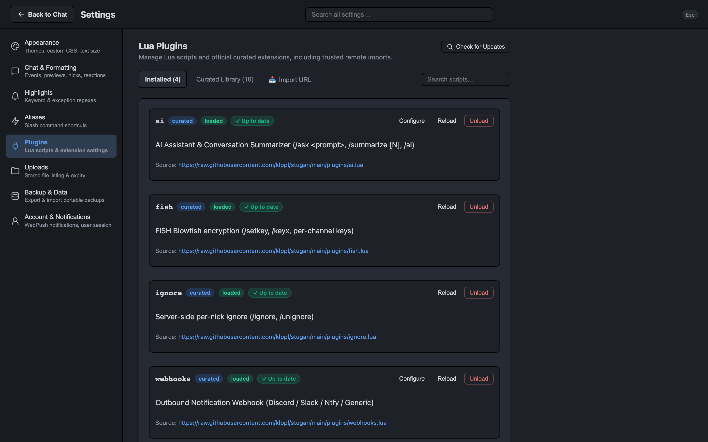

[](https://klppl.github.io/lagom-license/)

<p align="center">
  
</p>

<h1 align="center">stugan</h1>

<p align="center">
  A self-hosted, always-on web IRC client.<br>
  Written in Go, extended with Lua.
</p>

<p align="center">
  <a href="https://klppl.github.io/stugan/">Website</a> ·
  <a href="#quick-start">Quick start</a> ·
  <a href="docs/docker.md">Docker</a> ·
  <a href="plugins/">Plugins</a> ·
  <a href="#documentation">Docs</a>
</p>

<p align="center">
  
</p>

stugan is a daemon that holds your IRC connections 24/7 and keeps your history,
plus a Vue 3 web client that talks to it over WebSocket. Think
[TheLounge](https://thelounge.chat/) rewritten in Go, with the IRCv3 discipline
of [Halloy](https://github.com/squidowl/halloy) and a weechat/irssi-style Lua
plugin system.

## Features

- **Always on.** Stays connected and keeps history while your browser is closed.
- **Syncs everywhere.** Read markers, settings and unsent drafts follow you across devices.
- **Full-text search.** SQLite FTS5 trigram search over all your history.
- **Modern IRCv3.** Reactions, replies, typing, read markers, chathistory and [more](docs/ircv3.md).
- **Keyboard first.** Cmd/Ctrl-K jumper, irssi-style Tab completion, [shortcuts](docs/frontend.md#keyboard-shortcuts) for everything.
- **Lua plugins.** Commands, filters, hooks and timers, with hot reload and a curated library.
- **Previews & uploads.** Link previews, inline images and video, paste or drag to upload.
- **Built-in bouncer.** Connect WeeChat, HexChat, irssi or any other client too.
- **Restart without dropping IRC.** The optional [stugan-engine](docs/engine.md) sidecar holds the connections while stugan upgrades: no quit/rejoin flood, nothing missed.
- **SSH terminal UI.** Reach your session from any terminal.
- **Installable PWA.** Mobile friendly, with Web Push and desktop notifications.
- **Multi-user.** bcrypt logins with fully isolated networks and history.
- **Easy backups.** Export and restore everything in one click.

<table>
  <tr>
    <td width="28%"></td>
    <td><br><br></td>
  </tr>
</table>

## Quick start

**Docker** (amd64):

```sh
docker run -d --name stugan -p 8080:8080 -v stugan-data:/data \
  ghcr.io/klppl/stugan:latest
```

Put a `config.toml` with `listen = "0.0.0.0:8080"` in the `/data` volume, then
open `http://localhost:8080`. The [Docker guide](docs/docker.md) covers compose,
reverse proxy + TLS, `trusted_proxies` and updates. To keep IRC connected across
upgrades, run it with [stugan-engine](docs/engine.md) using
[`docker-compose.engine.yml`](docker-compose.engine.yml).

**From source:**

```sh
cd client && npm install && npm run build && cd ..
go build -o stugan ./cmd/stugan
go build -o stugan-engine ./cmd/stugan-engine   # optional, see docs/engine.md
./stugan                 # uses $STUGAN_HOME, else ~/.config/stugan
./stugan -home ./dev     # disposable config/data dir
```

For live client reload, run `./stugan` and `cd client && npm run dev` side by
side (Vite on :5173 proxies the WebSocket to :8080).

## Configuration

Everything lives under one root: `$STUGAN_HOME`, then
`$XDG_CONFIG_HOME/stugan`, then `~/.config/stugan`. stugan runs single-user and
unauthenticated by default; add `[[users]]` to require login. See
[docs/config.md](docs/config.md) and
[docs/config.example.toml](docs/config.example.toml).

## Plugins

Install from the [plugin library](plugins/) with `/load <name>` in chat, or
drop a script into `$STUGAN_HOME/scripts/`. Manage them under
**Settings → Plugins** or with `/load`, `/unload` and `/reload`.

| Plugin | What it does |
|--------|--------------|
| [`ai`](plugins/ai.lua) | `/ask` and `/summarize` with OpenAI, Claude, Gemini, DeepSeek or Ollama |
| [`webhooks`](plugins/webhooks.lua) | Forward highlights to Discord, Slack, ntfy or any webhook |
| [`fish`](plugins/fish.lua) | FiSH Blowfish encryption with `/setkey` |
| [`title`](plugins/title.lua), [`urls`](plugins/urls.lua), [`sed`](plugins/sed.lua), [`away`](plugins/away.lua), [`nickserv`](plugins/nickserv.lua), [`watch`](plugins/watch.lua), … | Everyday utilities |

Writing your own? See the [Lua API reference](docs/plugins.md).

<p align="center">
  
</p>

## Documentation

| Doc | What it covers |
|-----|----------------|
| [architecture](docs/layout.md) | Module/interface layout, dependency contract, data flow |
| [core](docs/core.md) | The engine, domain types, event bus, sinks, the plugin API surface |
| [protocol](docs/protocol.md) | The WebSocket wire protocol (envelope + every event) |
| [irc](docs/irc.md) | The IRC layer: girc wrapping, event translation, SASL |
| [ircv3](docs/ircv3.md) | IRCv3 capability matrix and roadmap |
| [storage](docs/storage.md) | SQLite schema, history, search, persistence |
| [server](docs/server.md) | HTTP/WebSocket server, multi-tenant hub, auth, security |
| [frontend](docs/frontend.md) | The Vue 3 client architecture |
| [theming](docs/theming.md) | Creating and installing custom themes |
| [docker](docs/docker.md) | Pulling the GHCR image and running it on a server |
| [plugins](docs/plugins.md) | The Lua plugin API |
| [ssh](docs/ssh.md) | SSH Terminal UI setup and usage |
| [bouncer](docs/ircserver.md) | Built-in IRC bouncer server (native client access) |
| [engine](docs/engine.md) | stugan-engine: keep IRC connected across stugan restarts |
| [config](docs/config.md) | Configuration reference |

## License

stugan is released under the [Lagom License](LICENSE): not too much, not too
little.

<sub>*stugan* is Swedish for “the cabin”.</sub>
